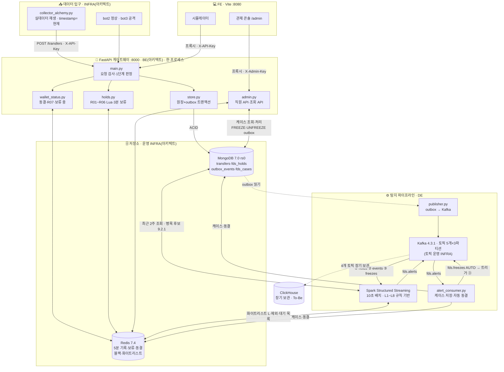

# Aegis-FDS 로컬 런북 — 담당 · 동작 확인 · 문제 찾기 (PoC)

> 대상: 컨테이너(Docker)·Kafka·Spark·MongoDB를 처음 쓰는 팀원 — Docker가 처음이면 2장부터
> 기준 코드: DE 브랜치(11/17, 게이트웨이·Spark·직원 API) + FE 브랜치(11/16, 시뮬레이터·관제 콘솔), 아키텍트 로컬 검증본
> 짝 문서: 룰 정의서 v2.4 PoC(무엇을 만드나) · E2E 체크리스트 시트(무엇을 통과했나) · CHANGES.md(로컬에서 무엇을 고쳤나)
> 셸: PowerShell. 프로젝트 최상단 폴더에서 실행

---

## 1. 담당 (11/18 확정 — BE 담당 FE 이동, BE는 아키텍트)

경계는 **파이프라인 단계**: 게이트웨이 안(검사 → 보류 → 저장) = BE, outbox 이후(발행 → Kafka → Spark → 경보 소비) = DE.

| 담당 | 파일·구간 | 구간 번호 |
| --- | --- | --- |
| **아키텍트 (BE)** | `fds/app/` `main.py` · `holds.py` · `wallet_status.py` · `whitelist.py` · `idempotency.py` · `store.py` · `admin.py` · `mongo_client.py` · `redis_client.py` · `Dockerfile`·`requirements.txt`(변경 시 DE 리뷰) | ① 게이트웨이 · ② 원장 · ⑧ 직원 API |
| **아키텍트 (INFRA)** | `docker-compose.yml` · `.env.example` · `collector/`(수집기·bot2·bot3) · 시드 스크립트 · 토픽 생성 · AWS 배포 · `web/vite.config.js`의 proxy 블록(FE 리뷰) · 이 런북 | ④ Kafka 운영 · ⑦ Redis · Mongo 운영 |
| **DE** | `fds/app/publisher.py` · `fds/app/alert_consumer.py` · `fds/spark/` 전체 · `fds/clickhouse/`(To-Be) | ③ 발행기 · ⑤ Spark · ⑥ 경보 소비자 |
| **FE** | `web/` 전체 (proxy 블록 제외) | ⑨ 관제·시뮬레이터 |
| **공용** | `fds/common/keys.py`(아키텍트 승인 + DE 리뷰) · `fds/README.md`(고친 사람이 자기 섹션) | — |

**담당 간 계약 — 바꾸기 전에 상대에게 알림**

| 계약 | 쓰는 쪽 | 읽는 쪽 |
| --- | --- | --- |
| `outbox_events` 문서 형식 | BE `store.py`·`admin.py` | DE `publisher.py` |
| `fds_holds` · `fds.holds.v1` | BE `store.py` | DE Spark (L1, 트리거 ①) |
| `transfer.events.v1` (필드 7개) | BE `store.py` | DE Spark |
| `fds_cases` 문서 형식 | DE `alert_consumer.py` + BE `admin.py`(처리 기록) | BE 조회 API → FE |
| Redis 동결 키 (`frozen_wallets`·`frozen_reasons`·`unfrozen_at`) | DE(자동) + BE(수동·해제) | BE 게이트웨이, DE Spark |
| `fds.freezes.v1` | DE(`AUTO`) + BE(`MANUAL`·`UNFREEZE`) | DE Spark (트리거 ③) |
| 관제 API 응답 형식 | BE `admin.py` | FE `web/src/admin/data/api.js` |

- **상태 변경은 직원 API 한 길로:** 동결·해제, 블랙리스트·화이트리스트 등록·해제는 `/api/v1/admin/...`로만. Redis를 직접 바꾸면 Mongo 이력·Kafka 이벤트·해제 시각(`fds:unfrozen_at`)이 빠져 해제한 지갑이 다시 동결되거나 기록이 남지 않는다.
  - Redis 직접 명령 허용: **조회만**(`SISMEMBER`, `GET`, `TTL`, `ZRANGE`, `SCARD`, `--scan`) + 테스트용 `DEL fds:hold:<지갑>`.

---

## 2. 컨테이너가 처음이라면

### 2.1 개념 5개

| 용어 | 뜻 | 우리 프로젝트에서 |
| --- | --- | --- |
| **이미지** | 프로그램 + 실행 환경을 묶은 설치 파일 | `mongo:7.0`, `apache/kafka:4.3.1`, 우리 게이트웨이 이미지 |
| **컨테이너** | 이미지를 실행한 것. 내 PC 안의 작은 독립 컴퓨터 | `aegis-gateway`, `aegis-mongo` … |
| **Docker Compose** | 여러 컨테이너를 `docker-compose.yml` 한 파일로 같이 띄움 | 게이트웨이·Redis·Mongo·Kafka·Spark 한 번에 |
| **포트 매핑** | 컨테이너 포트 ↔ 내 PC 포트 | `localhost:8000` → 게이트웨이 |
| **볼륨** | 컨테이너를 지워도 남는 데이터 저장소 | Mongo·Redis·Kafka·Spark 체크포인트 |

- 컨테이너끼리는 **서비스 이름**으로 부른다(게이트웨이 → `mongo:27017`, `kafka:9092`). 내 PC에서는 `localhost:매핑포트`.
- `docker exec <컨테이너> <명령>` = 그 컨테이너 안에서 명령 실행. Mongo·Kafka를 내 PC에 따로 설치할 필요가 없다.

### 2.2 우리 컨테이너

| 컨테이너 | 하는 일 | 내 PC 포트 | 담당 |
| --- | --- | --- | --- |
| `aegis-gateway` | 송금 API + 직원 API (FastAPI) | `8000` (LAN에도 열림) | 아키텍트 |
| `aegis-redis` | 1단계 5분 기록·보류·동결·목록 | `127.0.0.1:6379` | 아키텍트 |
| `aegis-mongo` | 원장·케이스·이력 (복제 세트 rs0) | `127.0.0.1:27017` | 아키텍트 |
| `aegis-publisher` | outbox → Kafka 전송 | 없음 | DE |
| `aegis-kafka` | 토픽 5개 | 없음 (`kafka:9092` 내부) | 아키텍트(운영) |
| `aegis-spark` | 2단계 L1~L8 (10초 배치) | 없음 | DE |
| `aegis-alert-consumer` | 경보 → 케이스·동결 | 없음 | DE |
| `aegis-clickhouse` | 장기 보관 (To-Be) | `127.0.0.1:8123` | 아키텍트 — **로컬 PoC에서는 끔** |

### 2.3 처음 띄우기 (Windows)

1. **Docker Desktop 실행** (고래 아이콘 "Engine running")
2. `.env` 준비: `.env.example` 복사 → `MONGO_URI`, `GATEWAY_API_KEY`, `ADMIN_API_KEY`, `CLICKHOUSE_PASSWORD` 값 입력. **`.env`는 절대 공유·커밋하지 않음**
3. 기동: `docker compose up -d --build`
4. **토픽 5개 생성 — Spark보다 먼저** (자동 생성 꺼짐. 없으면 Spark가 시작하다 멈춤):

```powershell
$topics = "transfer.events.v1","transfer.rejected.v1","fds.holds.v1","fds.alerts.v1","fds.freezes.v1"
foreach ($t in $topics) {
  docker exec aegis-kafka /opt/kafka/bin/kafka-topics.sh --bootstrap-server localhost:9092 --create --if-not-exists --topic $t --partitions 3 --replication-factor 1
}
docker compose restart spark     # 토픽보다 Spark가 먼저 떴다면
```

5. 상태 확인: `docker ps --format "table {{.Names}}\t{{.Status}}\t{{.Ports}}"`

| `STATUS` | 뜻 |
| --- | --- |
| `Up` / `Up (healthy)` | 정상 |
| `Restarting` | 죽고 다시 뜨기 반복 → `docker logs <이름> --tail 50` 맨 아래 오류부터 |
| `Exited (1)` | 오류로 종료 |

### 2.4 자주 쓰는 명령

```powershell
docker ps -a                                  # 종료된 것까지
docker logs aegis-gateway --tail 20           # 최근 로그
docker logs aegis-spark -f                    # 실시간 (Ctrl+C로 빠져나옴, 컨테이너는 계속 실행)
docker logs aegis-spark --since 5m
docker stats --no-stream                      # CPU·메모리
docker compose up -d --build gateway          # fds/app 코드 수정 후 (게이트웨이·publisher·alert-consumer 같은 이미지)
docker compose up -d --build publisher alert-consumer
docker compose restart spark                  # fds/spark 코드 수정 후 (코드는 볼륨 연결이라 재시작만)
docker compose up -d --build spark            # fds/spark/requirements.txt 바꿨을 때
docker compose stop                           # 전체 정지 (데이터 유지)
```

### 2.5 처음에 자주 하는 실수

| 실수 | 결과 | 이렇게 |
| --- | --- | --- |
| Docker Desktop 꺼짐 | `error during connect` | 켜고 재시도 |
| `fds/app` 고치고 `restart`만 | 반영 안 됨 | `docker compose up -d --build <서비스>` |
| **`docker compose down -v`** | **볼륨 삭제 → 모든 데이터 소실** | 정지는 `stop`. `-v`는 팀 합의 후만 |
| 컨테이너 이름 ↔ 서비스 이름 혼동 | 명령 실패 | `docker exec/logs` = 컨테이너 이름(`aegis-…`), `docker compose …` = 서비스 이름(`gateway`, `spark` …) |
| 줄 이어쓰기에 `\` | 명령 끊김 | PowerShell은 백틱 `` ` `` |
| `$ne`, `$W` 같은 문자열 | 변수로 해석 | 문자 그대로는 `` `$ne `` |
| 재시작부터 함 | 오류 로그가 밀려 사라짐 | **재시작 전 `docker logs --tail 50` 먼저** |
| Spark 계산 방식 바꾸고 그대로 재시작 | 옛 체크포인트와 충돌 | `CHECKPOINT_DIR`을 새 경로로 (DE) |

---

## 3. 전체 흐름



아래는 같은 흐름의 텍스트 버전 (구간 번호는 4장과 같음).

```text
[수집기 재생 · bot2 · bot3 · 시뮬레이터]  POST /api/v1/transfers  (헤더 X-API-Key)
     │
     ▼
① 게이트웨이 aegis-gateway ── 1단계 R01~R07 즉시 판정 (Redis, 최근 5분)
     │   통과 200 / 보류 429 + Retry-After / 차단 403
     ▼
② MongoDB aegis-mongo ── transfers(모든 요청) · fds_holds(새 보류) · outbox_events(보낼 이벤트) 를 한 트랜잭션으로
     │
     ▼
③ 발행기 aegis-publisher ── outbox → Kafka, PUBLISHED 표시
     │
     ▼
④ Kafka aegis-kafka ── transfer.events.v1 · transfer.rejected.v1 · fds.holds.v1 · fds.alerts.v1 · fds.freezes.v1
     │
     ▼
⑤ Spark aegis-spark ── 10초마다 transfer.events + fds.holds + fds.freezes 읽기, Mongo 최근 2주 조회 → L1~L8 → fds.alerts.v1
     │
     ▼
⑥ 경보 소비자 aegis-alert-consumer ── L1·L2·L3·L8 자동 동결 / L4~L7 검토 대기 → fds_cases, Redis 동결, fds.freezes.v1
     │
     ▼
⑦ Redis 상태 ── 동결 지갑 → 다음 송금 403 FROZEN_Ln
     │
⑧ 직원 API /api/v1/admin (헤더 X-Admin-Key) ── 수동 동결·이상 없음·해제·블랙/화이트리스트
⑨ 관제 콘솔 :8080/admin · 시뮬레이터 :8080
```

**문제를 찾는 원칙: 앞에서부터 한 구간씩.** 뒤가 조용하면 바로 앞 구간이 출력을 냈는지부터.

| 구간 | 담당 | 한 줄 확인 |
| --- | --- | --- |
| ① 게이트웨이 | 아키텍트 | `docker logs aegis-gateway --tail 5` |
| ② 원장 | 아키텍트 | `transfers`에 그 `tx_hash`가 있나 |
| ③ Outbox·발행기 | DE (outbox 형식은 BE) | `PUBLISHED`인가, "발행 완료 n건" |
| ④ Kafka | 아키텍트 | 토픽 5개, 메시지 도착 |
| ⑤ Spark | DE | `batch=` 로그의 `seconds` < 10 |
| ⑥ 경보 소비자 | DE | "새 케이스", "지갑 동결" 로그 |
| ⑦ Redis | 아키텍트 | `SISMEMBER fds:frozen_wallets` |
| ⑧ 직원 API | 아키텍트 | `GET /api/v1/admin/wallets/{w}` |
| ⑨ 관제·시뮬레이터 | FE | 화면·네트워크 탭 |

---

## 4. 구간별 확인

공통 변수 (매 PowerShell 창에서 한 번):

```powershell
$EnvFile = ".\.env"
function Get-EnvValue($name) { ((Get-Content $EnvFile | Select-String "^\s*$name\s*=").ToString() -split "=", 2)[1].Trim() }
$GW  = @{ "Content-Type" = "application/json"; "X-API-Key"   = (Get-EnvValue "GATEWAY_API_KEY") }
$ADM = @{ "Content-Type" = "application/json"; "X-Admin-Key" = (Get-EnvValue "ADMIN_API_KEY") }
function New-TxHash { "0x" + (New-Guid).ToString("N") + (New-Guid).ToString("N") }   # 실행마다 새 해시 (중복 409 방지)
```

### ① 게이트웨이 — 아키텍트

**하는 일:** 송금 요청을 검사 순서대로 판정. 키 → 금액 → 시각 → 지갑 상태(동결·블랙리스트·보류 중) → 중복 → R05 → R01·R02·R04 → R03·R06.

```powershell
$body = @{ tx_hash = (New-TxHash); log_index = 0
  from = "0x1111111111111111111111111111111111111111"; to = "0x2222222222222222222222222222222222222222"
  amount = 100.0; block = 1000000; timestamp = (Get-Date).ToUniversalTime().ToString("yyyy-MM-ddTHH:mm:ssZ") } | ConvertTo-Json
try { $r = Invoke-WebRequest -Uri "http://localhost:8000/api/v1/transfers" -Method Post -Headers $GW -Body $body -UseBasicParsing
      "HTTP $($r.StatusCode) $($r.Content)" }
catch { "HTTP $([int]$_.Exception.Response.StatusCode) $($_.ErrorDetails.Message)  Retry-After=$($_.Exception.Response.Headers['Retry-After'])" }
docker logs aegis-gateway --tail 3
```

| 응답 | 뜻 |
| --- | --- |
| `200 ACCEPTED` | 통과 (R03·R06은 통과 + 받는 지갑 보류) |
| `429 TEMP_HOLD_Rxx` + `Retry-After` | 보류 걸림 또는 보류 중 |
| `403 FROZEN_Ln` / `FROZEN_MANUAL` | 보내는 지갑 동결 |
| `403 BLACKLISTED_SENDER/RECEIVER` | R07 |
| `401 UNAUTHORIZED` | `X-API-Key` 없음·틀림 (저장 안 됨) |
| `409 DUPLICATE_REQUEST` | 같은 `tx_hash`+`log_index` 재전송 |
| `422 TIMESTAMP_OUT_OF_RANGE` | 시각이 서버와 **30초** 넘게 차이 → 재생 데이터는 현재 시각으로 바꿔 보낼 것 |
| `422 INVALID_AMOUNT` | 0 이하 또는 소수 6자리 초과 |
| `422` (reason 없음) | JSON 형식 오류 (필드 누락 등, 저장 안 됨) |
| `503 FDS_UNAVAILABLE` | Redis·Mongo 장애 |

- PowerShell에서 `curl.exe`로 JSON을 보내면 따옴표가 깨진다. `ConvertTo-Json` 사용.
- R01 5번째 거래 동작은 11/09 확정안(`200` 통과 + 보류, 6번째부터 보류 중 `429`) 기준으로 확인.

### ② MongoDB 원장 — 아키텍트

```powershell
docker exec aegis-mongo mongosh aegis --quiet --eval "db.transfers.find().sort({_id:-1}).limit(3)"
docker exec aegis-mongo mongosh aegis --quiet --eval "db.fds_holds.find().sort({held_at:-1}).limit(3)"
docker exec aegis-mongo mongosh aegis --quiet --eval "db.transfers.getIndexes()"
```

| 정상 | 이상 |
| --- | --- |
| `transfers`에 `http_code`·`status`·`reason`, 보류면 `fds_holds`에 `rule`·`side`·`held_at` | 응답은 왔는데 기록 없음 → 게이트웨이 로그 "기록 저장 실패" |

- `transfers` 자동 삭제는 **꺼 둔 상태**(`TRANSFERS_TTL_DAYS=0`). ClickHouse 연결 전에는 켜지 않는다.

### ③ Outbox · 발행기 — DE (outbox 문서 형식은 BE `store.py`)

**Transactional Outbox:** 원장 저장과 "보낼 이벤트" 저장을 한 트랜잭션으로 묶어, Kafka가 잠깐 죽어도 이벤트가 사라지지 않게 한다.

```powershell
docker exec aegis-mongo mongosh aegis --quiet --eval "db.outbox_events.find().sort({_id:-1}).limit(2)"
docker exec aegis-mongo mongosh aegis --quiet --eval "db.outbox_events.countDocuments({publish_state:'PENDING'})"
docker logs aegis-publisher --tail 5
```

| 정상 | 이상 |
| --- | --- |
| `publish_state: PUBLISHED`, "발행 완료 n건" 시각이 요청과 맞음 | `PENDING`이 계속 늘어남 → 발행기·Kafka 연결 확인 |

### ④ Kafka — 아키텍트

| 용어 | 뜻 |
| --- | --- |
| 토픽 / 파티션 | 메시지 게시판 / 그 안의 칸 (우리는 3개, 같은 지갑은 같은 칸 → 순서 유지) |
| 오프셋 | 칸 안 메시지 번호 |
| 컨슈머 그룹 / 랙 | 같이 읽는 묶음 / 아직 안 읽은 수 (계속 늘면 못 따라가는 중) |

```powershell
$K = "/opt/kafka/bin"
docker exec aegis-kafka $K/kafka-topics.sh --bootstrap-server localhost:9092 --list
docker exec aegis-kafka $K/kafka-console-consumer.sh --bootstrap-server localhost:9092 --topic transfer.events.v1 --from-beginning --max-messages 1
docker exec aegis-kafka $K/kafka-console-consumer.sh --bootstrap-server localhost:9092 --topic fds.alerts.v1 --from-beginning --max-messages 5
docker exec aegis-kafka $K/kafka-consumer-groups.sh --bootstrap-server localhost:9092 --describe --all-groups
```

- `--from-beginning`은 읽기만 한다. 서비스 컨슈머 위치에 영향 없음.

### ⑤ Spark — DE

| 용어 | 뜻 |
| --- | --- |
| 마이크로배치 / 트리거 | 10초마다 모아서 한 번에 처리 (`TRIGGER_INTERVAL`, 기본 10초) |
| 배치 처리 시간 | 배치 하나 계산 시간. **10초보다 충분히 짧아야** 밀리지 않음 |
| `maxOffsetsPerTrigger` | 밀렸을 때 한 배치에 읽을 최대 메시지 (기본 50,000) |
| 체크포인트 | 어디까지 읽었나 저장. 계산 방식 바꾸면 새 경로 |
| 시계 신호(`rate`) | 거래가 없어도 1초에 1줄 읽어 대기 목록 처리 |

```powershell
docker logs aegis-spark --tail 30
docker logs aegis-spark --since 10m | Select-String "batch=|falling behind|ERROR|Exception"
```

- 배치 로그 예: `batch=42 {"analyzed": 3, "alerts": 1, "pending_size": 0, ..., "seconds": 2.1}` — 할 일이 있던 배치만 찍힌다.

| 정상 | 이상 → 뜻 |
| --- | --- |
| `seconds` 가 10보다 충분히 작음, `pending_size` 가 늘지 않음 | **`Current batch is falling behind`** → 배치가 10초를 넘김 (정상 아님) |
| `profile=demo` 시작 로그 | `UnknownTopicOrPartition` → 토픽 없음 (2.3-4) |

**falling behind 볼 순서:** ① `docker stats`로 자원 (ClickHouse 꺼져 있나) ② `seconds`가 큰 배치의 `analyzed` 수 ③ `transfers` 인덱스 `[from,timestamp]`·`[to,timestamp]` ④ `PERIOD_PROFILE=demo` 인가. 결과는 정의서 9.2 실측값.

### ⑥ 경보 소비자 — DE

```powershell
docker logs aegis-alert-consumer --tail 10
docker exec aegis-mongo mongosh aegis --quiet --eval "db.fds_cases.find({}, {rule_id:1, violator_address:1, risk_level:1, action_taken:1, review_status:1, detected_at:1}).sort({_id:-1}).limit(5)"
```

| 정상 | 이상 |
| --- | --- |
| "새 케이스 L1 … 자동 동결" / "검토 대기", "지갑 동결 … (L1)" | 로그가 비어 있음 → 경보가 날 시나리오를 아직 안 돌린 것 (정상) |
| `action_taken`: `WALLET_FROZEN`(L1·L2·L3·L8) / `REVIEW_PENDING`(L4~L7) | 경보는 있는데 저장 없음 → 화이트리스트 `L`, 해제 전 거래 경보(건너뜀 로그) 확인 |

### ⑦ Redis 상태 — 아키텍트 (조회만)

```powershell
$W = "0x1111111111111111111111111111111111111111"
docker exec aegis-redis redis-cli SISMEMBER fds:frozen_wallets $W        # 동결 1
docker exec aegis-redis redis-cli HGET fds:frozen_reasons $W             # 동결 사유 (L1 등)
docker exec aegis-redis redis-cli GET "fds:hold:$W"                      # 보류 룰
docker exec aegis-redis redis-cli TTL "fds:hold:$W"                      # 남은 초 (-2 없음)
docker exec aegis-redis redis-cli ZRANGE "fds:w:send:$W" 0 -1 WITHSCORES # R01 5분 기록
docker exec aegis-redis redis-cli SCARD fds:whitelist:R01
docker exec aegis-redis redis-cli --scan --pattern "fds:hold:*"
```

- **`KEYS *` 금지** (Redis 전체 멈춤). `--scan` 사용.
- 바꾸는 건 ⑧ 직원 API로. 예외: 테스트 중 보류만 빨리 풀 때 `docker exec aegis-redis redis-cli DEL "fds:hold:$W"`.

### ⑧ 직원 API — 아키텍트

POST 본문에 공통으로 `operator`(직원 ID), `memo`(사유)가 들어간다. 화이트리스트는 메모 필수.

```powershell
$A = "http://localhost:8000/api/v1/admin"
function Admin($method, $path, $obj) {
  $b = if ($obj) { $obj | ConvertTo-Json -Depth 5 } else { $null }
  try { Invoke-RestMethod -Uri "$A$path" -Method $method -Headers $ADM -Body $b }
  catch { "HTTP $([int]$_.Exception.Response.StatusCode) $($_.ErrorDetails.Message)" }
}

Admin GET  "/wallets/$W"                                                   # 동결·사유·블랙/화이트리스트·보류 남은 초
Admin POST "/blacklist" @{ wallets = @("0xbad0000000000000000000000000000000000001"); operator = "arch"; memo = "R07 시연" }
Admin POST "/blacklist/0xbad0000000000000000000000000000000000001/remove" @{ operator = "arch"; memo = "시연 종료" }
Admin POST "/whitelist" @{ wallet = $W; rules = @("R01","R04"); operator = "arch"; memo = "L7 시연 지갑" }
Admin POST "/whitelist/$W/remove" @{ rules = @("R01","R02","R03","R04","R05","R06"); operator = "arch"; memo = "시뮬레이터 일괄 면제 해제" }
Admin POST "/wallets/$W/unfreeze" @{ operator = "arch"; memo = "소명 확인" }
Admin POST "/cases/<케이스 _id>/freeze"  @{ operator = "arch"; memo = "검토 후 동결" }
Admin POST "/cases/<케이스 _id>/dismiss" @{ operator = "arch"; memo = "정상 거래" }
```

| 응답 | 뜻 |
| --- | --- |
| `503 ADMIN_API_DISABLED` | `.env`에 `ADMIN_API_KEY` 없음 |
| `401` | 직원 키 틀림 |
| `409 NOT_PENDING` / `NOT_FROZEN` / `NOT_LISTED` | 상태가 맞지 않음 (검토 대기 아님, 동결 아님, 목록에 없음) |
| `422` | `operator` 없음, 모르는 룰, 화이트리스트 메모 없음 |

### ⑨ 관제 콘솔 · 시뮬레이터 — FE

```text
브라우저 F12 → Network: /api/v1/transfers, /api/v1/admin/* 의 상태 코드·응답
```

| 확인 | 기대 |
| --- | --- |
| 실데이터 연결 여부 | `VITE_API_BASE`가 비어 있으면 브라우저 Mock 데이터 (실데이터 아님) |
| 시뮬레이터 송금 | `401`이면 키 미주입 → Vite 프록시가 서버 쪽에서 `X-API-Key` 추가 (아키텍트) |
| 고객 문구 | 429: "처리 중입니다. 잠시 후 다시 시도해 주세요." / 403: "현재 요청을 처리할 수 없습니다. 자세한 사항은 고객센터로 문의해 주세요." |

---

## 5. 따라가 보기

### 5.1 정상 송금 1건이 Spark까지 (아키텍트 → DE)

1. ① 송금 → `200`, 게이트웨이 로그
2. ② `transfers`에 같은 해시
3. ③ `outbox_events` 최신 `PUBLISHED`, 발행기 로그 시각 일치
4. ④ `transfer.events.v1`에서 그 해시
5. ⑤ Spark 다음 배치 `batch=` 로그 (`analyzed` ≥ 1)
6. ⑥ 정상 송금이면 경보 소비자는 조용한 게 정상

### 5.2 L1 자동 동결 → 해제 (DE → 아키텍트)

1. 화이트리스트 없는 지갑으로 R01 보류 3회 (demo 20분 안, 보류마다 `DEL fds:hold` 또는 3분 대기)
2. `fds_holds` 3건, `fds.holds.v1` 3건
3. ⑤ 다음 배치(10초 안) → `fds.alerts.v1`에 L1
4. ⑥ "지갑 동결 … (L1)" → ⑦ `SISMEMBER fds:frozen_wallets` = 1
5. ① 같은 지갑 송금 → `403 FROZEN_L1`, 그 지갑으로 입금 → `200`
6. ⑧ `POST /wallets/{w}/unfreeze` → `UNFROZEN`, 다시 송금 `200`

### 5.3 L5 소급 (블랙리스트 등록)

1. 지갑 A가 X에게서 2,000 받음 (`200`)
2. ⑧ `POST /blacklist` X 등록
3. ⑤ 다음 배치들에서 X의 상대 A 재계산 (배치당 500개) → L5 CRITICAL `REVIEW_PENDING`
4. A 출금은 `200` 유지 (검토 대기는 막지 않음) → 관제 수동 동결 시 `403 FROZEN_L5`

---

## 6. 증상별 찾기

| 증상 | 먼저 볼 곳 | 원인 → 조치 | 담당 |
| --- | --- | --- | --- |
| 송금 `401` | 요청 헤더 | `X-API-Key` 없음 → 키·프록시 | 아키텍트 |
| 송금 `422` 시각 | ① | 재생 데이터 시각 → 현재 시각으로 | 아키텍트 |
| 1단계가 하나도 안 걸림 | ⑧ `GET /wallets/{w}` | 화이트리스트 면제 → `POST /whitelist/{w}/remove` | 아키텍트 |
| 같은 요청 두 번째 `409` | — | 해시 재사용 → `New-TxHash` | 아키텍트 |
| Spark 시작하다 멈춤 | ④ 토픽 목록 | 토픽 없음 → 생성 후 `restart spark` | 아키텍트 |
| `falling behind` | ⑤ `batch=` `seconds` | 자원·ClickHouse·인덱스 → 4.⑤ 순서 | DE |
| outbox `PENDING` 증가 | ③ 발행기 로그 | Kafka 연결 → 재시작·주소 | DE (Kafka 운영은 아키텍트) |
| 경보는 있는데 동결 없음 | ⑥ 케이스 `action_taken` | L4~L7은 원래 검토 대기 · 화이트리스트 `L` · 이미 동결 | DE |
| 해제했는데 곧 다시 동결 | 해제 방법 | Redis 직접 삭제함 → 직원 API `unfreeze`로 (해제 시각 기록) | 아키텍트 |
| 블랙리스트 등록 후 L5가 늦음 | `SCARD fds:recheck_l5` | 배치당 500개 처리 → 대기 | DE |
| 관제 화면이 계속 그럴듯한데 실데이터와 다름 | `VITE_API_BASE` | Mock 모드 → 조회 API 연결 후 설정 | FE · 아키텍트 |
| Redis 재시작 후 목록 비었음 | `CONFIG GET appendonly` | AOF 확인 (compose에 `--appendonly yes`) → 직원 API로 재등록 | 아키텍트 |

---

## 7. 용어 미니 사전

| 용어 | 한 줄 |
| --- | --- |
| 이미지 / 컨테이너 | 설치 파일 / 그걸 실행한 독립 실행 환경 |
| Docker Compose | 여러 컨테이너를 yml 한 파일로 같이 띄움 |
| 볼륨 | 컨테이너를 지워도 남는 데이터 (`down -v`로 삭제) |
| 멱등성 | 여러 번 해도 결과가 같음 (멱등키 `idemp:*`, `SADD`, 직원 API 재요청) |
| Transactional Outbox | DB 저장 + 보낼 이벤트 저장을 한 트랜잭션으로 → 유실 방지 |
| 컨슈머 랙 | 아직 안 읽은 메시지 수 |
| 마이크로배치 | N초마다 모아서 처리 |
| falling behind | 배치 처리 시간 > 트리거 간격 |
| `PERIOD_PROFILE` | `demo` 20분·5분·1분·15초 / `prod` 2주·24시간·1시간·60초 |
| 직원 API | `/api/v1/admin` — 상태 변경의 유일한 경로 (`X-Admin-Key`) |
