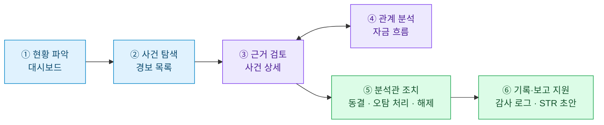
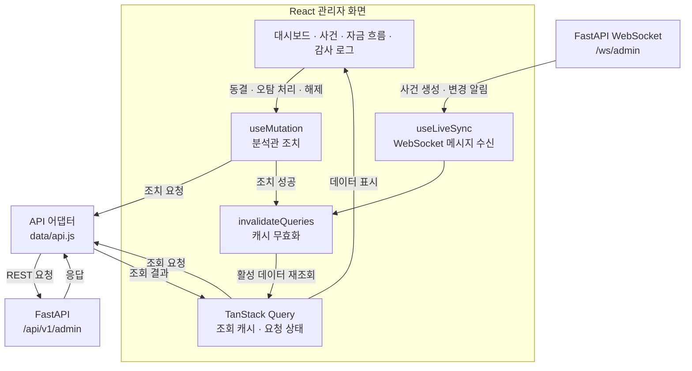

# 🛡️ Aegis-FDS Frontend

### 경보 확인부터 근거 분석·조치·보고 초안까지, 하나의 관제 흐름으로

React 기반의 **가상자산 이상거래 관제 웹 애플리케이션**입니다. FastAPI에서 제공하는 거래·탐지 결과를 검색 가능한 목록, 근거 차트, 지갑 관계 그래프로 연결해 분석관의 판단을 지원합니다.

`React` · `Vite` · `TanStack Table` · `TanStack Query` · `React Flow` · `Recharts`

| 🔎 사건 탐색 | 📊 근거 확인 | 🔗 자금 흐름 | 📝 대응·보고 |
|:---:|:---:|:---:|:---:|
| 조건 검색·정렬·필터 | 실측값과 기준값 비교 | 지갑·거래 관계 시각화 | 분석관 조치·STR 초안 |

> **핵심 가치** — 거래와 경보를 보여주는 데서 나아가, **어떤 사건을 검토하고 왜 조치해야 하는지** 화면에서 확인할 수 있도록 구성했습니다.

[관제 흐름](#관제-흐름) · [화면별 기능](#화면별-기능) · [기술 구성](#기술-구성) · [데이터 연동](#데이터-연동) · [실행 방법](#실행-방법) · [구현 범위](#구현-범위)

---

## 관제 흐름



*분석관의 사용 흐름을 나타낸 도식입니다. STR 초안은 사건 상세에서 열 수 있으며, 조치를 완료해야만 조회할 수 있는 것은 아닙니다.*

## 화면별 기능

| 화면 | 주요 기능 | 분석관이 확인하는 것 |
|---|---|---|
| **대시보드** | 거래 추이·경보 현황·룰별 건수, 지표에서 목록으로 이동 | 지금 우선 검토할 사건은 무엇인가? |
| **경보 목록** | 조건 검색·필터·정렬·페이지 이동 | 특정 지갑이나 조건에 해당하는 사건은 무엇인가? |
| **사건 상세** | 탐지 근거·관련 거래·지갑 요약·분석관 조치·STR 초안 | 왜 탐지됐고, 어떤 대응이 필요한가? |
| **자금 흐름** | 지갑 관계 그래프·시간 및 금액 필터 | 자금이 어느 지갑으로 이동했는가? |
| **실시간 거래** | 게이트웨이 판정 기록·메인넷 원본 스트림 조회 | 거래가 어떤 결과로 처리됐는가? |
| **감사 로그** | 조치 이력 조회·CSV 내려받기 | 누가, 언제, 왜 조치했는가? |
| **시스템 상태** | 서비스 상태 조회·5초 주기 갱신 | 연결된 서비스의 상태는 어떠한가? |

사용자 송금 시뮬레이션(`/`)과 관리자 관제(`/admin/`)는 별도 진입점입니다. **통계·분석 기능은 메인 대시보드에 통합**되어 있습니다.

### 🔎 사건 탐색 — 필요한 경보로 범위 좁히기

| 검색·필터 | 지원 항목 |
|---|---|
| 검색어 | 지갑 주소 · 사건 ID · 룰 ID |
| 사건 조건 | 탐지 룰 · 처리 상태 · 데이터 출처 |
| 거래 조건 | 최소 금액 · 탐지 기간 |
| 목록 조작 | 탐지 시각·위험 등급·금액 등 정렬 · 페이지 이동 |

TanStack Table의 정렬·페이지 이동 기능에 화면의 조건 필터를 결합했습니다. 목록에서 **위험 등급과 주요 탐지 근거를 확인한 뒤 사건 상세로 이동**합니다.

### 📊 근거 분석 — 숫자와 거래 내역으로 판단 지원

- **실측값 ↔ 기준값:** 탐지 근거를 비교해 경보 발생 이유를 확인합니다.
- **관련 거래·지갑 요약:** 송수신 금액, 거래 상대, 보류 이력 등을 함께 검토합니다.
- **분석관 조치:** 동결·오탐 처리·동결 해제를 요청하고 이력을 확인합니다.
- **STR 초안:** 조회·다운로드와 분석관 의견 저장을 지원합니다.

> STR은 의심거래보고 초안입니다. 분석관 검토를 지원하며, 보고기관에 자동 제출하지 않습니다.

### 🔗 자금 흐름 — 지갑 관계와 탐지 경로 시각화

| 표현·조작 | 의미 |
|---|---|
| 지갑 노드 | 대상·제재·동결 지갑과 기타 지갑 구분 |
| 방향이 있는 연결선 | 송신 → 수신 관계 표현 |
| 선의 색·굵기 | 탐지 경로 강조 · 거래 금액 반영 |
| 1·2단계 관계 조회 | 직접 거래 상대에서 상대의 거래 관계까지 탐색 |
| 금액·시간 범위 필터 | 분석 대상 거래 범위 조절 |
| 지갑 선택·확대·축소 | 선택 지갑 정보와 전체 관계 확인 |

React Flow로 **백엔드가 제공한 거래 관계와 탐지 경로**를 표시합니다. 그래프 화면은 `React.lazy`로 필요할 때 불러옵니다.

### 📈 통계 모니터링 — 전체 현황에서 개별 사건으로

- **경보 현황:** 검토 대기·자동 동결·직원 동결·오탐 처리 건수
- **거래 추이:** Recharts 기반 거래 유입·보류·차단·자동 동결 시계열
- **검토 대상:** 룰별 건수·위험 지갑 목록
- **화면 연결:** 주요 지표 클릭 → 해당 목록 또는 사건 상세 이동

---

## 기술 구성

| 기술 | 적용 영역 | 구현 포인트 |
|---|---|---|
| **React · Vite** | 화면 구성·개발·빌드 | 사용자·관리자 진입점 분리, 컴포넌트 재사용 |
| **TanStack Table** | 사건·거래 목록 | 정렬·페이지 이동과 조건 필터 결합 |
| **React Flow** | 자금 흐름 | 지갑·거래를 노드·연결선으로 표현 |
| **Recharts** | 대시보드·사건 상세 | 거래 추이와 사건 관련 거래를 차트로 표시 |
| **TanStack Query** | 서버 데이터 관리 | 조회 캐시·재조회·요청 상태·조치 요청 관리 |
| **공통 UI · Sonner** | 화면 일관성·알림 | 카드·모달·상태·주소·금액·근거 표시 재사용, 결과 토스트 |

### 프론트엔드에서 강화한 관제 경험

| 관점 | 구현 내용 | 사용자가 얻는 기능 |
|---|---|---|
| **탐색** | 조건 필터와 정렬 가능한 목록 | 검토 대상 사건을 좁혀 확인 |
| **분석** | 근거 비교·거래 관계 그래프 | 탐지 이유와 지갑 간 이동 관계를 함께 검토 |
| **모니터링** | 통계 차트와 상세 화면 연결 | 전체 현황에서 개별 사건으로 이동 |
| **데이터 갱신** | WebSocket과 Query 캐시 무효화 연계 | 사건 변경 후 서버 데이터를 다시 조회 |
| **유지보수** | API 어댑터·Query 훅·공통 UI 분리 | 조회 로직과 표시 요소를 공통으로 관리 |

*위 내용은 현재 구현의 기능적 특징입니다. 탐색 시간 단축이나 API 호출량 감소를 수치로 측정한 성능 결과는 아닙니다.*

## 데이터 연동



| 데이터 처리 | 현재 동작 |
|---|---|
| 조회 | `useQuery`로 사건·통계·그래프·거래·감사 로그 등 조회 |
| 분석관 조치 | `useMutation` 요청 성공 후 Query 캐시 무효화 |
| 실시간 사건 알림 | `case_created` / `case_updated` 수신을 계기로 데이터 갱신 |
| WebSocket 수신 처리 | 메시지 종류를 구분하지 않고 전체 Query 캐시 무효화 → 활성 조회 재요청 |
| 시스템 상태 | 별도로 5초마다 재조회 |

**WebSocket은 변경 알림, REST API는 화면 데이터 조회를 담당합니다.** 사건 생성·수정 알림을 기준으로 갱신하며, 모든 거래마다 WebSocket 알림이 발생하는 구조는 아닙니다.

## 코드 구조

```text
web/
├─ index.html                 # 사용자 송금 화면 진입점
├─ admin/index.html           # 관리자 관제 화면 진입점
├─ vite.config.js             # 빌드·개발 서버·API/WS 프록시
└─ src/
   ├─ user/                   # 사용자 송금 시뮬레이션
   ├─ lib/                    # 송금 API·온체인 조회 등
   └─ admin/
      ├─ AdminApp.jsx         # 관제 레이아웃·화면 연결·Query Provider
      ├─ ui.jsx               # 카드·모달·상태·탐지 근거 등 공통 UI
      ├─ auth.js              # 시연용 로그인·역할 구분
      ├─ pages/               # 대시보드·경보·사건 상세·자금 흐름 등
      └─ data/
         ├─ api.js            # FastAPI API 어댑터
         └─ hooks.js          # 조회·조치·실시간 갱신 훅
```

---

## 실행 방법

### 1. 설치 및 실행

Node.js와 npm이 필요합니다. Node.js는 설치된 Vite 버전의 지원 범위를 충족해야 합니다. 저장소 루트에서 실행합니다.

```bash
cd web
npm ci
npm run dev
```

| 접속·명령 | 용도 |
|---|---|
| `http://localhost:8080/` | 사용자 송금 시뮬레이션 |
| `http://localhost:8080/admin/` | 관리자 관제 |
| `npm run build` | 사용자·관리자 페이지 빌드 |
| `npm run preview` | 빌드 결과 미리보기 |

### 2. FastAPI 연동 설정

[.env.example](.env.example)을 참고해 `web/.env.local`을 설정하고 개발 서버를 재시작합니다. 기존 파일이 있다면 필요한 값만 변경합니다.

| 설정 | 값·역할 |
|---|---|
| `VITE_API_BASE` | `/` — 개발 프록시를 통한 API 호출 |
| `VITE_PROXY_TARGET` | 백엔드 주소, 예: `http://localhost:8000` |
| `VITE_PERIOD_PROFILE` | 백엔드 기간 설정에 맞춰 `demo` 또는 `prod` |

FastAPI 연동 예시:

```dotenv
VITE_API_BASE=/
VITE_PROXY_TARGET=http://localhost:8000
VITE_PERIOD_PROFILE=demo
```

저장소 루트 `.env`에는 백엔드와 동일한 `GATEWAY_API_KEY`, `ADMIN_API_KEY`를 설정합니다. Vite 개발 프록시가 서버 측에서 인증 헤더를 추가합니다. **키는 브라우저에 노출되는 `VITE_` 변수에 넣지 않습니다.**

시연 계정은 [auth.js](src/admin/auth.js)를 참고하세요. 배포 시에는 `/api`, `/ws` 프록시와 인증 헤더 전달을 별도로 구성해야 하며, `preview`가 이를 대신하지 않습니다.

## 기능 확인 체크리스트

| 확인 대상 | 확인 방법 |
|---|---|
| 사건 탐색 | 경보 목록에서 주소 검색·상태 필터·금액 정렬·페이지 이동 |
| 근거·조치 | 사건 상세에서 실측값·기준값 확인, 분석관 계정으로 조치 후 상태 확인 |
| 자금 흐름 | 지갑 선택·확대·축소·시간 범위 및 금액 필터 확인 |
| 통계 | 기간 변경에 따른 차트 조회와 지표 클릭 후 목록 이동 확인 |
| 실시간 갱신 | `/ws/admin` 연결 후 사건 알림 수신 → API 재조회 → 화면 갱신 확인 |
| 보고·기록 | STR 초안 조회·다운로드, 감사 로그 조회·CSV 내려받기 |

*위 표는 실행 환경에서 확인할 검증 절차이며, 전체 기능의 통합 테스트 완료를 의미하지 않습니다.*

## 구현 범위

| 구분 | 현재 범위 |
|---|---|
| **프론트엔드 성과** | 사건 탐색·근거 분석·자금 흐름·통계·조치·보고 지원을 관제 흐름으로 연결 |
| **탐지 및 처리 성능** | FDS 탐지 정확도와 Spark 처리 성능 향상은 프론트엔드 성과에 포함하지 않음 |
| **시연 기능** | 송금 화면은 실제 자산을 전송하지 않으며, 로그인·역할 구분은 시연용 |
| **검증 성적표** | 대시보드 검증 성적표는 예시 값 |
| **연결 복구** | WebSocket 자동 재연결 미구현 — 서버 복구 후 화면 새로고침 필요 |

## 관련 코드·문서

[화면 연결](src/admin/AdminApp.jsx) · [화면별 구현](src/admin/pages) · [공통 UI](src/admin/ui.jsx) · [API 어댑터](src/admin/data/api.js) · [Query·실시간 훅](src/admin/data/hooks.js)

[API 명세](../docs/API_SPECIFICATION.md) · [화면 사용 매뉴얼](docs/manual.html)
